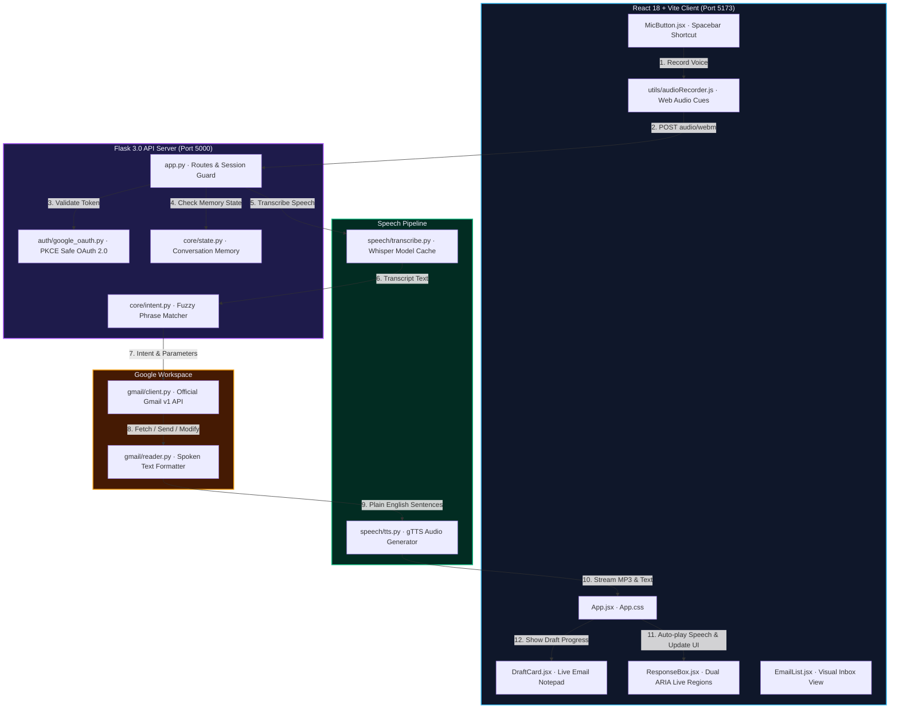
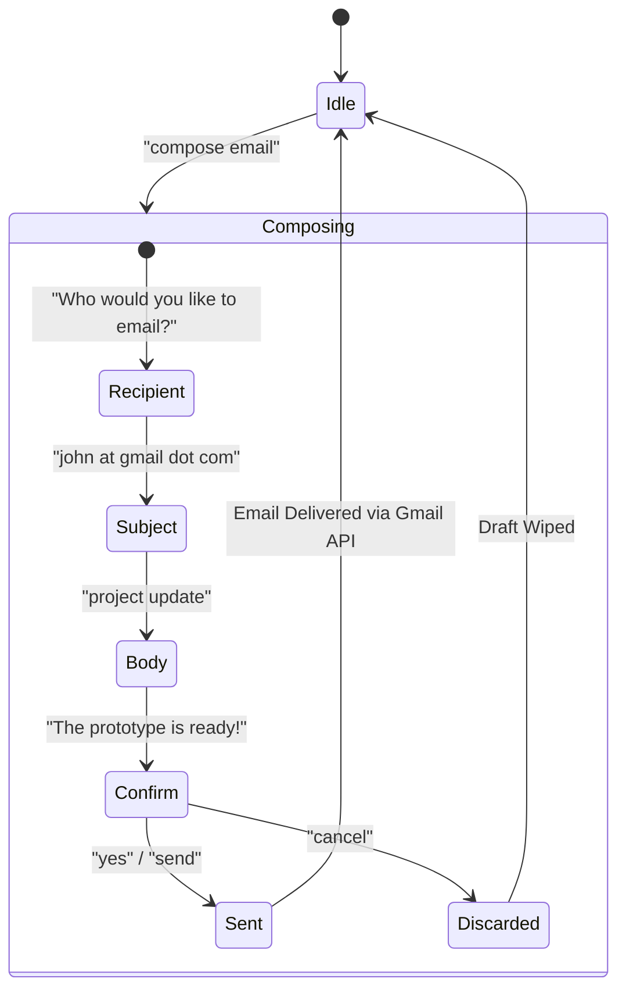

<div align="center">

# ✦ V O C A M A I L ✦
### *Voice-First Gmail for Everyone*

**Eyes-free · Hands-free · Screen-reader ready**

---


</div>

---

## ▌What is VocaMail?

VocaMail is an **eyes-free, voice-first Gmail interface** engineered specifically for blind users, users with motor impairments, and anyone seeking a seamless hands-free email experience. 

Instead of requiring sight to browse lists or fine motor skills to type and point with a mouse, VocaMail operates through natural speech. Tap <kbd>Space</kbd>, speak a command, and VocaMail transcribes your voice, carries out your Gmail action, and speaks the reply aloud.

---

## ▌Complete Voice Turn Lifecycle


---

## ▌Full System Architecture



---

## ▌Supported Voice Commands

| Voice Command | Action Description | Example Spoken Input |
|---|---|---|
| **Read Inbox** | Fetches and reads your 5 latest emails with sender & subject | *"read my inbox"*, *"check my emails"*, *"what's new"* |
| **Read Full Email** | Opens a specific email and reads its full body text aloud | *"read email 1"*, *"open the second email"*, *"read message 3"* |
| **Compose Email** | Launches the step-by-step voice dictation wizard | *"compose email to alice@example.com about meeting tomorrow"* |
| **Search Emails** | Queries Gmail for any sender, keyword, or topic | *"search for amazon receipts"*, *"find emails from GitHub"* |
| **Archive Email** | Removes an email from INBOX (stored safely in All Mail) | *"archive email 1"*, *"archive the second email"* |
| **Delete Email** | Moves an email into Gmail's Trash folder | *"delete email 3"*, *"trash message 1"* |
| **Mark as Read** | Clears the UNREAD flag on an email | *"mark email 1 as read"*, *"mark as read"* |
| **Confirm Action** | Confirms sending an email during the compose flow | *"yes"*, *"send"*, *"send it"*, *"confirm"* |
| **Cancel Action** | Discards active draft and resets to main menu | *"cancel"*, *"stop"*, *"abort"*, *"nevermind"* |
| **Help** | Narrates all available voice commands | *"help"*, *"what can you do"*, *"commands"* |
| **Log Out** | Guides user to sign out of their Google account | *"log out"*, *"sign out"* |

---

## ▌Multi-Turn Email Composition Wizard



During composition:
- The glowing **`DraftCard`** live-updates on screen showing `To`, `Subject`, `Message Body`, and current step.
- Spoken email addresses like *"john dot doe at gmail dot com"* are automatically normalized to *"john.doe@gmail.com"*.
- Saying *"cancel"* at any turn immediately discards the draft.

---

## ▌Repository Layout

```
vocamail/
│
├── app.py                      ← Flask API server, session management, voice pipeline
├── config.py                   ← Settings & environment loader (.env)
├── requirements.txt            ← Python dependencies (Whisper, Flask, gTTS, Google APIs)
├── .env.example                ← Environment template
│
├── auth/
│   └── google_oauth.py         ← OAuth 2.0 flow with PKCE session persistence
│
├── core/
│   ├── intent.py               ← Fuzzy voice intent detector (rapidfuzz)
│   └── state.py                ← Session memory state machine (get/set/reset/update)
│
├── gmail/
│   ├── client.py               ← list_inbox, send_email, search, archive, trash, mark_read
│   └── reader.py               ← Formats email dicts into natural spoken sentences
│
├── speech/
│   ├── transcribe.py           ← Whisper Speech-to-Text (Local CPU / OpenAI API fallback)
│   └── tts.py                  ← gTTS voice synthesizer (MP3 generator & cleaner)
│
├── tests/
│   ├── __init__.py             ← Test suite package
│   ├── test_intent.py          ← 15 unit tests covering all voice commands
│   ├── test_state.py           ← 3 unit tests for session conversation lifecycle
│   └── test_reader.py          ← 3 unit tests for email speech formatting
│
└── frontend/                   ← React 18 + Vite Single Page Application
    ├── package.json            ← React 18, Vite, lucide-react
    ├── vite.config.js          ← Proxies /api, /login, /oauth to Flask on :5000
    ├── index.html              ← HTML shell with skip-links and viewport
    └── src/
        ├── main.jsx            ← React 18 createRoot mount
        ├── index.css           ← Global tokens, nebula theme, typography
        ├── App.jsx / App.css   ← Orchestrator, auth state, voice turn coordinator
        ├── utils/
        │   └── audioRecorder.js← Web Audio recorder with 440Hz / 300Hz accessibility beeps
        └── components/
            ├── Header.jsx / Header.css         ← Accessible navigation & sign out
            ├── LoginCard.jsx / LoginCard.css   ← Glassmorphism Google sign-in card
            ├── StatusBadge.jsx / StatusBadge.css← Pulsing LED status (Ready, Listening, Speaking)
            ├── MicButton.jsx / MicButton.css   ← Push-to-talk button with purple focus ring
            ├── DraftCard.jsx / DraftCard.css   ← Live voice email draft visualizer
            ├── ResponseBox.jsx / ResponseBox.css← Dual ARIA live region speech subtitles
            └── EmailList.jsx / EmailList.css   ← Visual inbox cards with unread badges
```

---

## ▌Getting Started

### Prerequisites

- **Python 3.10+**
- **Node.js 18+** & npm
- **Google Account** with Gmail enabled

### 1. Clone & Configure

```bash
git clone https://github.com/ankushsingh003/vocamail-voice-first-gmail.git
cd vocamail-voice-first-gmail
```

Copy the environment template:
```bash
cp .env.example .env
```
Fill in your `GOOGLE_CLIENT_ID` and `GOOGLE_CLIENT_SECRET` from Google Cloud Console.

### 2. Install Dependencies

**Backend:**
```bash
pip install -r requirements.txt
```

**Frontend:**
```bash
cd frontend
npm install
cd ..
```

### 3. Run Automated Tests

Run all 21 unit tests:
```bash
python -m unittest discover tests
```

### 4. Start the Application

**Terminal 1 — Backend (Flask on port 5000):**
```bash
python app.py
```

**Terminal 2 — Frontend (Vite on port 5173):**
```bash
cd frontend
npm run dev
```

Open **`http://localhost:5173`** in your browser, sign in with Google, and press <kbd>Space</kbd> to begin speaking!

---

## ▌Accessibility Standards (WCAG 2.1 AA)

- **Auditory Cues (Web Audio API):** Clean 440 Hz start tone and 300 Hz stop tone let blind users know exactly when recording starts and ends without looking at the screen.
- **Dual ARIA Live Regions:** Urgent updates (*"Listening…"*, *"Processing…"*) use `aria-live="assertive"`, while assistant responses use `aria-live="polite"` to avoid clobbering screen reader speech.
- **Keyboard Navigation:** Full keyboard navigation using <kbd>Space</kbd> or <kbd>Enter</kbd> to record; bright purple `:focus-visible` outlines for low-vision navigators.
- **Auto-Focus Management:** Keyboard focus returns smoothly to the microphone button after every voice turn.

---

## ▌License

Distributed under the MIT License. Built with ❤️ for accessibility and voice-first interaction.
