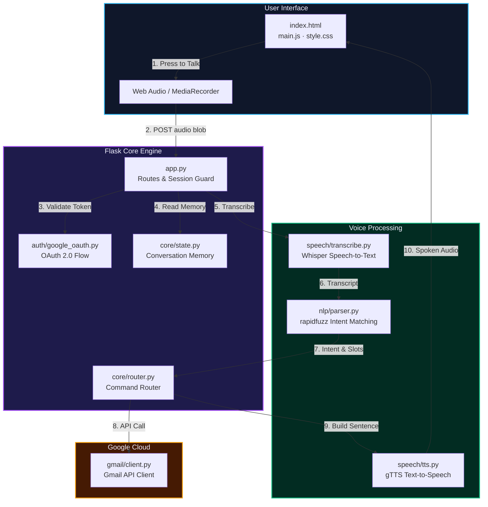
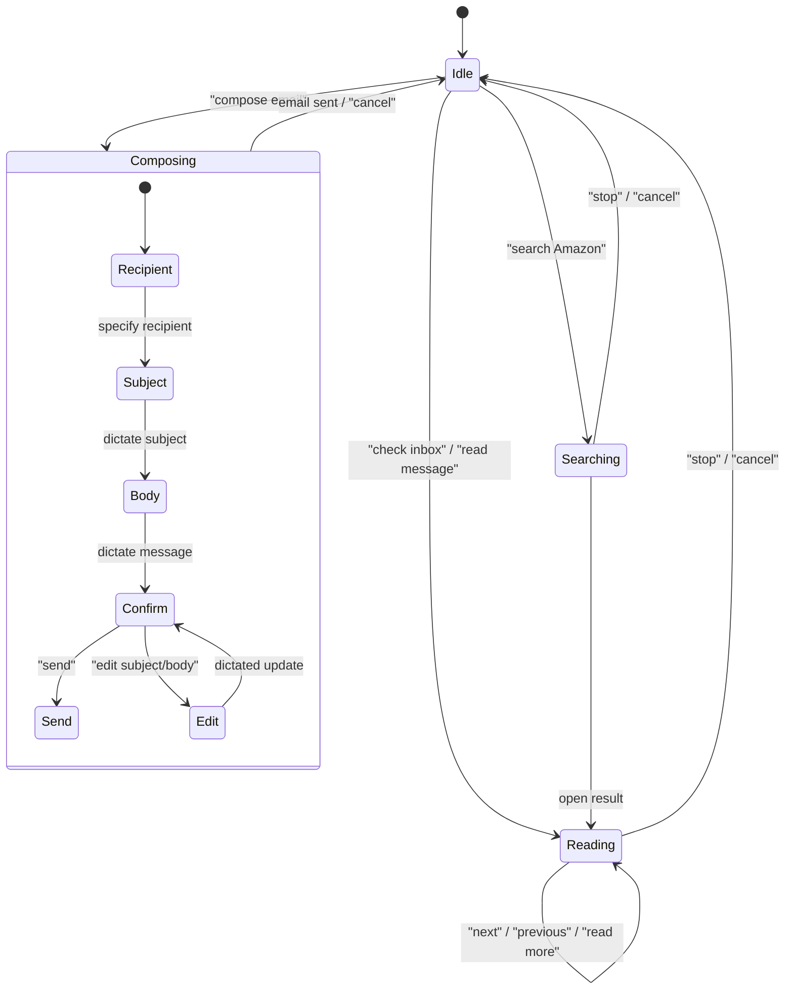

<div align="center">

# ✦ V O C A M A I L ✦
### *Voice-First Gmail for Everyone*

**Eyes-free · Hands-free · Screen-reader ready**

---


</div>

---

## ▌What is VocaMail?

VocaMail is a **voice-first Gmail client** built for people who navigate the web by voice — including blind users, users with motor impairments, and anyone who wants a hands-free email experience. You press a key, speak a command, and VocaMail reads your inbox aloud, composes messages by dictation, and confirms before sending.

No mouse. No screen scanning. Just your voice.

---

## ▌One Conversation Turn — How It Works


---

## ▌System Architecture



---

## ▌Folder Structure

```
vocamail/
│
├── app.py                  ← Flask entry point, all routes
├── config.py               ← Central settings (reads from .env)
├── requirements.txt        ← Python dependencies
├── .env.example            ← Template — copy to .env and fill in
├── .gitignore
│
├── auth/
│   └── google_oauth.py     ← Build URL · Exchange code · Refresh · Revoke
│
├── speech/
│   ├── transcribe.py       ← Whisper wrapper: audio file → transcript text
│   └── tts.py              ← gTTS wrapper: speak(text) → mp3 file path
│
├── nlp/
│   ├── intents.py          ← Intent → keyword/phrase pattern dictionary
│   └── parser.py           ← detect_intent() · extract_slots()
│
├── core/
│   ├── router.py           ← State-aware command router
│   ├── state.py            ← Session state helpers (get/set/update/reset)
│   └── handlers/
│       ├── inbox.py        ← READ_INBOX, READ_MESSAGE, NEXT, PREVIOUS
│       ├── compose.py      ← COMPOSE multi-turn state machine
│       ├── reply.py        ← REPLY, FORWARD
│       └── search.py       ← SEARCH, FILTER
│
├── gmail/
│   └── client.py           ← list · get · send · reply · modify · trash
│
├── static/
│   ├── js/
│   │   ├── main.js         ← App init, ARIA announcer, status badge
│   │   ├── recorder.js     ← MediaRecorder, push-to-talk (Phase 2)
│   │   └── audio.js        ← TTS audio playback, beep sounds (Phase 2)
│   ├── css/
│   │   └── style.css       ← Dark mode · Glassmorphism · Animations
│   └── audio/              ← Temp mp3 files (auto-deleted, gitignored)
│
└── templates/
    └── index.html          ← Single-page app: login + voice interface
```

---

## ▌Tech Stack

| Layer | Technology | Purpose |
|---|---|---|
| **Web Framework** | Flask 3.0 | Routes, session management, local server |
| **Voice Capture** | Web Audio API / MediaRecorder | Browser microphone → audio blob |
| **Speech-to-Text** | OpenAI Whisper (Local / API) | Audio transcription |
| **Intent Parsing** | rapidfuzz + Regex | Fast phrase matching & slot extraction |
| **Email Backend** | Gmail API v1 | Read, send, search, label, and modify emails |
| **Authentication** | Google OAuth 2.0 | Secure token-based Google login |
| **Text-to-Speech** | gTTS | Spoken response generation (`.mp3`) |
| **Accessibility** | ARIA Live Regions + WCAG 2.1 AA | Screen reader announcements & high contrast |
| **Styling** | Vanilla CSS | Dark mode, glassmorphism, responsive layout |

---

## ▌Conversation State Machine



---

## ▌Getting Started

### Prerequisites

- **Python 3.10+** (tested on Python 3.13)
- **ffmpeg** (needed if running local Whisper model)
- **Google Account** with Gmail enabled
- **Git**

### 1. Clone the repository

```bash
git clone https://github.com/ankushsingh003/vocamail-voice-first-gmail.git
cd vocamail-voice-first-gmail
```

### 2. Install Python dependencies

```bash
pip install -r requirements.txt
```

### 3. Set up Google Cloud (One-time)

1. Go to [Google Cloud Console](https://console.cloud.google.com).
2. Create a project named **VocaMail**.
3. Enable the **Gmail API** under **APIs & Services > Library**.
4. Configure **OAuth consent screen** (External) and add your Gmail as a **Test User**.
5. Under **Credentials**, click **Create Credentials > OAuth client ID** (Web application).
6. Set **Authorized redirect URI** to:
   ```
   http://localhost:5000/oauth/callback
   ```
7. Copy your **Client ID** and **Client Secret**.

### 4. Configure environment variables

```bash
cp .env.example .env
```

Open `.env` and fill in:

```env
FLASK_SECRET_KEY=your-random-secret-key
GOOGLE_CLIENT_ID=your-client-id.apps.googleusercontent.com
GOOGLE_CLIENT_SECRET=your-client-secret
```

### 5. Run the application

```bash
python app.py
```

Open your browser to: **http://localhost:5000** and click **Sign in with Google**.

---

## ▌API Reference

| Method | Route | Purpose |
|---|---|---|
| `GET` | `/` | Main single-page application (login wall if not authed) |
| `GET` | `/login` | Starts the Google OAuth 2.0 consent flow |
| `GET` | `/oauth/callback` | Google redirect callback, exchanges tokens |
| `GET` | `/api/session` | Returns current conversation state as JSON |
| `GET` | `/api/inbox` | Fetches the 5 latest email summaries |
| `POST` | `/api/voice` | Core voice pipeline: audio blob → transcript → Gmail → TTS |
| `POST` | `/logout` | Clears all session keys and tokens |

### `POST /api/voice` Payload & Response

```json
// Response
{
  "ok": true,
  "transcript": "check my inbox",
  "text": "You have 3 unread emails. First, from Amazon: Your order has shipped.",
  "audio_url": "/static/audio/response_123.mp3",
  "state": {
    "mode": "reading",
    "current_index": 0
  }
}
```

---

## ▌Accessibility Design

| Feature | Implementation |
|---|---|
| **ARIA Live Regions** | `role="status"` and `aria-live="polite"` announce all updates to screen readers |
| **Keyboard Navigation** | <kbd>Space</kbd> key triggers push-to-talk; full tab order with visible outline |
| **High Contrast Theme** | Dark mode with crisp near-white text on deep space background (WCAG AA compliant) |
| **Visual Indicators** | Color + text status badge (Ready, Listening, Processing, Speaking) |
| **Audio Loop Protection** | TTS playback is muted while microphone is actively recording |

---

## ▌Security & Privacy

- **Server-Side Session Storage:** Tokens are stored in server session memory only and never exposed to client-side scripts.
- **Immediate Audio Cleanup:** Temporary audio recordings and generated MP3 clips are removed after playback.
- **Zero Email Content Storage:** Email contents are streamed directly to voice output and never saved to a database or logged to disk.
- **Protected Environment:** `.env` is ignored by Git to prevent credential leaks.

---

## ▌License

Distributed under the MIT License. See [LICENSE](LICENSE) for details.

---

<div align="center">

**Built for the people who never got to use email the way they deserved.**

✦ **VocaMail — Your voice is the interface** ✦

</div>
